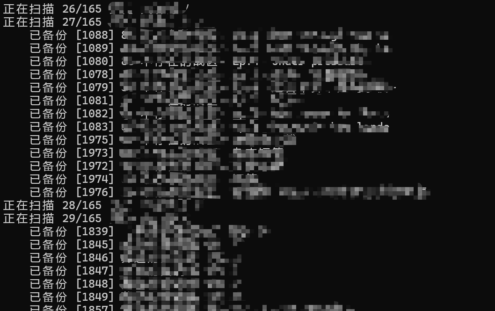
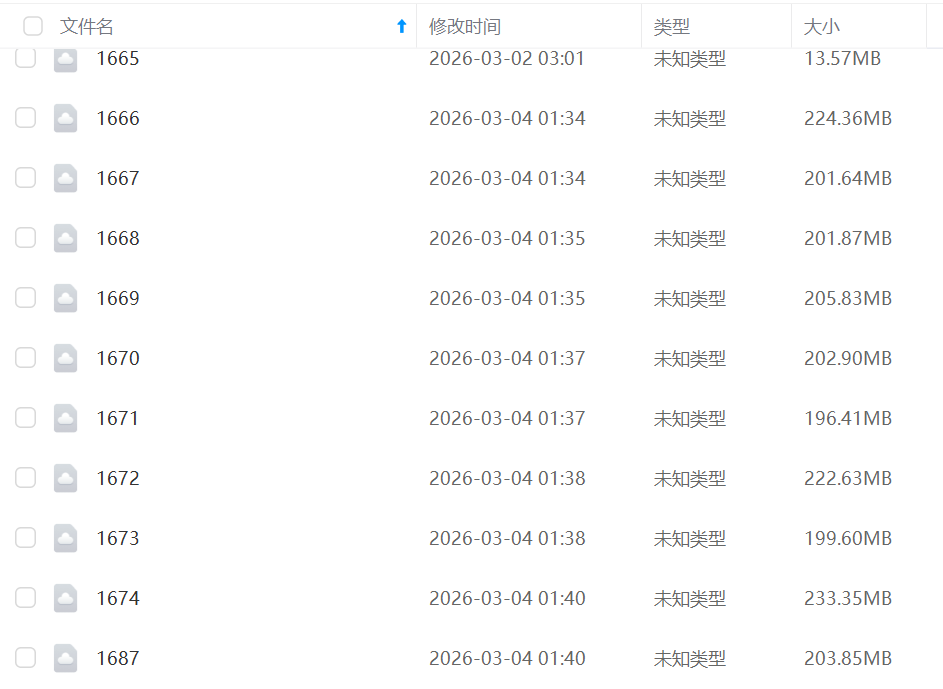

# [calibre] 书库备份

将 [calibre] 便携式书库备份到百度网盘，会使用 7z 加密压缩，并为每本书使用不同的随机密码，避免内容被和谐。

网盘上每本书使用一个以电子书 id 命名的目录，备份文件为 `{id}/{groupName}`：书籍较小时只有一个 `all` 文件，较大时会按照文件类型拆分成 `epub`、`meta`、`data` 等分组；历史记录用 `{groupName} {yyyy-MM-dd} {哈希前8位}` 保存在同一个目录中（日期是这份备份的创建日期，哈希是内容寻址：同一份快照永远得到同一个名字、与修改时间无关，同一天的不同快照也不会撞名；如果同一天已经存过完全相同的内容，就直接丢掉当前这份、不重复保存）。这样每本书的首层只会占用一个目录，便于长期管理。

早先版本留下的历史记录只有日期、没有哈希，会在**这本书下次要写入新历史记录时**顺带改名成新格式（各自补上自己的哈希），所以同一个分组里的历史命名始终一致；没改动过的书不会主动去列目录，等它下次变化时再补齐。迁移旧命名时也会直接把历史记录搬成带哈希的新格式。

备份信息（含书籍基本信息以及密码）会存储到书库根目录的 `.backup-config.json`。备份信息本身，以及 [calibre] 书库的 `metadata.db`、`metadata_db_prefs_backup.json` 也会被分到网盘的 `config` 文件中。

`config` 的密码**由备份目录派生**（SHA-256，24 位字母数字），不是随机生成：`config` 里存着每本书的密码，而它自己也在 `config` 里，密码不可能来自 `config` 本身；用备份目录派生之后，只要知道备份目录（网盘上就看得见）就能解开 `config`，完全没有本地文件也能恢复整个书库。只有真的要备份时才换密码，没有变化的那次运行不会动它。代价是知道备份目录的人也能解开 `config`，加密只用来避免内容被扫描、被和谐；想让强度高一些可以加 `--key` 掺一个额外口令进去（会保存到配置里），但恢复时也要提供同样的值。

备份配置里的路径一律归一化成 `/` 分隔并做 Unicode NFC 归一化（`Dir` 也一样），所以在 Windows 和 macOS 之间交替备份时，不会因为路径分隔符或 Unicode 形式不同把同一批文件当成新文件重新打包上传。压缩时也是按「相对书籍目录的路径」添加文件，归档里会保留子目录结构（例如 `data/…`），恢复时能原样还原。

会根据电子书的最后修改时间以及 MD5 区分是否发生了改变，只重新上传发生修改的电子书，上传后会覆盖旧版本。

判断云盘上的备份是否还在时，靠的是书籍目录的修改时间：每次运行只列一次备份根目录（迁移完成后约 2~3 页），把每本书目录的修改时间和上次记录的值比对，**时间没变的书直接跳过、不再列目录**；时间变了、或者还没记录过的书才单独列一次目录确认。上传、改名、删除、迁移之后会作废并重新记录该时间。

旧版本直接将 `{id}`、`{id}_{group}` 作为备份文件名，会在目录内保留大量文件。备份前会自动迁移这些旧文件：先批量把与目录同名的文件改名（一次请求最多 100 个），再创建同名目录，最后将旧文件移动到目录中。文件名只会变短，内容未发生改变时直接移动旧数据，不会删除后重新上传。

备份过程：



备份结果：

```
/书库备份
├── 1665
│   ├── all
│   ├── all 2026-02-27 3f2a1b8c
│   └── all 2026-03-02 91de77a4
├── 1666
│   ├── epub
│   ├── epub 2026-03-01 5c0d9e21
│   ├── meta
│   └── meta 2026-03-01 77b3aa10
├── 1667
│   └── all
└── config
```

迁移前的命名方式，所有备份文件都堆在同一个目录中：



## 从备份恢复

只要还记得网盘的备份目录，就可以在一台没有书库、也没有任何本地配置的机器上重建整个书库：

```powershell
calibre-backup restore D:\Calibre -d /书库备份
```

- `path`：恢复到的本地目录，默认为当前目录；
- `-d, --dir`：备份时使用的网盘目录，config 的密码就是由它派生的，**必须与备份时一致**；
- `-k, --key`：备份时用 `--key` 设过额外口令的话，这里要给同样的值（目标目录里已有 `.backup-config.json` 时会自动用它的）。

流程：

1. 下载根目录的 `config`，用派生出的密码解开（`-mhe` 连文件名也加密了），得到 `.backup-config.json`（每本书的密码、作者、书名和文件清单）以及 `metadata_backup.db`；
2. 逐本拉取 `{id}/{group}`，用这本书自己的密码解开，再按 `{作者}/{书名} ({id})` 放回 calibre 的书目录结构；
3. `metadata_backup.db` 还原成 `metadata.db`，`metadata_db_prefs_backup.json` 一起写回；
4. 目标目录里没有 `.backup-config.json` 时，把从 `config` 里解出来的那份写进去，之后可以直接在这份书库上继续备份（密码、历史记录都能对上）。

单本书失败不会中断整体，最后会列出失败的书。临时文件都放在目标目录的 `.backup-restore` 里，结束时删除。

## 清理历史记录

历史记录（`{分组名} {yyyy-MM-dd} {哈希前8位}`）和当前备份放在同一个目录里，时间久了会占不少空间。想把它们一次性删掉、又不动当前的备份：

```powershell
calibre-backup clear-history D:\Calibre
```

- `path`：书库目录，默认为当前目录；备份路径直接用它 `.backup-config.json` 里记录的值，不用再指定；
- `-y, --yes`：删除前不再询问。

它先扫一遍，列出「几本书共几个历史记录、多大」，确认之后才真的删。判定依据是文件名里的 ` yyyy-MM-dd`，所以当前备份（`all`、`epub`、`meta`、`data` 这些不带日期的名字）和根目录的 `config` 都不会被碰到；根目录下旧命名方式留下的历史文件也不在这一步处理。单本书删除失败不影响其它书，最后会列出来。

## 环境要求

- 7z 命令行工具。
- 百度网盘的 AppKey 和 SecretKey，具体步骤参考[创建应用](https://pan.baidu.com/union/doc/fl0hhnulu)。

## 发布 exe 的注意事项

在带「低完整性」标签的目录（例如本工作区）里 `dotnet publish` 出来的 exe 会继承该标签，Windows 会按低完整性启动这个进程，于是它写不了普通（中等完整性）文件，授权时就会报：

```
Error: Access to the path 'D:\Workspace_Tools\utils\baidu-pan\access-token.config.json' is denied.
```

用工作区根目录的 `publish-exe.cmd`（内部转 `publish-exe.ps1`）发布最省事：它默认输出到 `$env:USERPROFILE\bin`，发布完逐个用 `icacls` 检查 exe 的完整性级别，级别不对就打印需要手动执行的命令。

```powershell
.\publish-exe.cmd                 # 发布所有 .cs 到 %USERPROFILE%\bin
.\publish-exe.cmd -SkipPublish    # 只检查已有 exe
.\publish-exe.cmd -Name calibre-backup -OutDir D:\tools
```

直接 `.\publish-exe.ps1` 可能报「未对文件进行数字签名」——本机对未签名脚本的限制比执行策略更严（`Get-ExecutionPolicy` 显示 RemoteSigned 也会被拒，`-ExecutionPolicy Unrestricted` 同样不行，只有 `Bypass` 能跑）。`.cmd` 内部已经带了 `-ExecutionPolicy Bypass`，等价的手动写法是：

```powershell
powershell -NoProfile -ExecutionPolicy Bypass -File .\publish-exe.ps1
```

也可以手动发布到工作区外（新文件的标签随目标目录）：

```powershell
dotnet publish calibre-backup.cs -o "$env:USERPROFILE\bin"
```

已经在工作区里的 exe，可以用管理员终端把标签改回来：

```powershell
icacls "<exe 路径>" /setintegritylevel Medium
```

自查：`icacls <exe 路径> | findstr /i Mandatory`，显示 `Low Mandatory Level` 就是有问题的，没有输出（或 `Medium`）才正常。

注意新文件的标签是 `min(发布进程的完整性, 输出目录的完整性)`：在受限/沙箱终端里发布，即使输出到普通目录，产物也是 Low。

工具启动时会自检进程完整性，检测到低完整性会直接打印警告和修复命令，不用等到写文件失败才发现。

发布完脚本默认会把 exe **复制回当前目录**（方便直接 `.\calibre-backup.exe`），复制后重新检查完整性：

- 覆盖**已存在**的同名 exe → 保留原有标签，原先 Medium 就还是 Medium；
- 当前目录原本**没有**同名 exe（新建）→ 继承工作区的低标签变 Low，脚本会打印 `icacls "<路径>" /setintegritylevel Medium`，在管理员终端执行一次即可；

```powershell
.\publish-exe.cmd                  # 发布 + 复制回当前目录
.\publish-exe.cmd -NoCopyBack      # 只发布到 %USERPROFILE%\bin，不复制回来
.\publish-exe.cmd -SkipPublish     # 不重新编译，只复制/检查
```

## 用法

```
calibre-backup [path] [OPTIONS]                    # 备份
calibre-backup restore [path] [OPTIONS]            # 恢复
calibre-backup clear-history [path] [OPTIONS]      # 清理历史记录
```

备份参数：

- `path`：要备份的 calibre 书库目录，默认为当前目录。

备份选项：

- `-l, --list`：列出备份文件信息，会将备份路径（书籍目录）、密码、尺寸等输出到书库根目录的 `.backup-data.csv`。
- `-d, --dir`：网盘的备份目标路径。会保存到配置中，只指定一次即可。
- `-k, --key`：参与派生 config 密码的额外口令，会保存到配置中，只指定一次即可。设了就要记住，恢复时要用它。
- `--history`：保留的备份历史个数，默认为 3。

备份途中按 `Ctrl+C` 会立刻把已经处理完的进度写进 `.backup-config.json`，然后直接退出（退出码 130），不等正在进行的压缩和上传。所以正在传的那本书的「当前备份」可能还没写完——云端的旧版本仍然以历史记录的形式留在同一个目录里，下次运行会重新打包上传。写配置期间不会再响应 Ctrl+C，避免把配置文件写坏。

恢复参数和选项见上面的[从备份恢复](#从备份恢复)，清理历史记录见[清理历史记录](#清理历史记录)。

[calibre]: https://calibre-ebook.com/zh_CN
